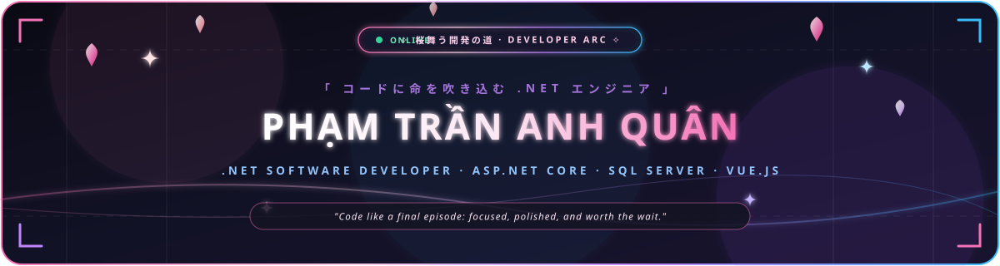
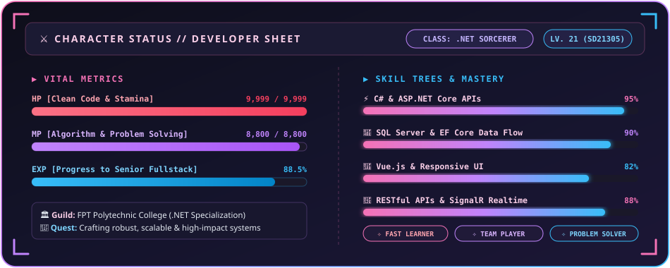

  

  

  
  
  
  

  

---

## ⚔️ Character Sheet // Developer Arc

  

---

## 🌸 About The Developer

> *"Every line of code is a frame of animation; make sure each one brings the story to life."*

I am a .NET-focused software development student currently in my FPT Polytechnic journey. My passion lies in engineering resilient backend architectures, fluent APIs, and expressive user experiences.

- 🎓 **Academy / Guild**: FPT Polytechnic College · Software Development (.NET)
- 🏷️ **Class Arc**: SD21305
- 🎯 **Primary Specialization**: ASP.NET Core, Entity Framework Core, SQL Server & Vue.js
- ⚡ **Passive Buffs**: Clean code mindset, fast documentation digestion, reliable problem diagnostics
- 🌐 **Communication**: Vietnamese (Native), English (Technical Fluency)

---

## 📜 Skill Tree & Grimoire

<table>
  <tr>
    <th width="50%" align="left">🔮 Backend &amp; Architecture Sorcery</th>
    <th width="50%" align="left">🎨 Frontend Alchemy</th>
  </tr>
  <tr>
    <td valign="top">
      
      
      
      
      
      
      
      
    </td>
    <td valign="top">
      
      
      
      
      
    </td>
  </tr>
  <tr>
    <th width="50%" align="left">💾 Database Sanctum</th>
    <th width="50%" align="left">🛠️ Dev Arsenal &amp; Tools</th>
  </tr>
  <tr>
    <td valign="top">
      
      
      
    </td>
    <td valign="top">
      
      
      
      
      
      
    </td>
  </tr>
</table>

---

## 🗺️ Quest Log // Featured Projects

<table>
  <!-- Top Tier: Enterprise & AI Solutions -->
  <tr>
    <td width="50%" valign="top">
      <h3>🌟 <a href="https://github.com/nhubui2008/Manage-KPI-or-OKR-System">Manage-KPI-or-OKR-System</a></h3>
      

        
        
      

      
<em>Enterprise-grade KPI &amp; OKR management platform integrated with AI Advisors (DeepSeek &amp; Gemini RAG), automated check-in evaluations, 45+ EF Core entity models, and robust SQL Server architecture.</em>

      

        
        
        
        
        
      

    </td>
    <td width="50%" valign="top">
      <h3>🔮 <a href="https://github.com/quanptatb/OmniBizAI">OmniBizAI</a></h3>
      

        
      

      
<em>Modern .NET 10 ERP &amp; business intelligence suite featuring OKR/KPI setup, CRM pipelines, inventory logistics, Redis caching, and automated multi-stage approval workflows.</em>

      

        
        
        
        
        
      

    </td>
  </tr>

  <!-- Full-Stack & Creative Realms -->
  <tr>
    <td width="50%" valign="top">
      <h3>🌸 <a href="https://github.com/quanptatb/Gimai_Seikatsu">Gimai_Seikatsu</a></h3>
      
<em>Anime-inspired full-stack web application exploring modern reactive UI flows, structured APIs, and sleek state integration.</em>

      

        
        
        
        
      

    </td>
    <td width="50%" valign="top">
      <h3>🚜 <a href="https://github.com/quanptatb/Construction-equipment-store">Construction-equipment-store</a></h3>
      
<em>Commercial machinery &amp; heavy equipment trading platform featuring full product catalog indexing, quote generation, and order processing flows.</em>

      

        
        
        
        
      

    </td>
  </tr>

  <!-- Enterprise Coursework & E-Commerce -->
  <tr>
    <td width="50%" valign="top">
      <h3>⚡ <a href="https://github.com/quanptatb/SOF3081_NHOM3">SOF3081_NHOM3</a></h3>
      
<em>Comprehensive team project applying enterprise ASP.NET Core patterns, Entity Framework Core data layers, and clean workflows.</em>

      

        
        
        
      

    </td>
    <td width="50%" valign="top">
      <h3>📦 <a href="https://github.com/quanptatb/ShopBanHang">ShopBanHang</a></h3>
      
<em>Full e-commerce platform handling catalog data, customer carts, orders, and transactional database integrity.</em>

      

        
        
        
      

    </td>
  </tr>
</table>

---

## 📊 Activity & Battle Metrics

  
  

  

---

  

  

  ✦ Crafted with 🌸 by <strong>Phạm Trần Anh Quân</strong> · <em>"dev to the end"</em> ✦

